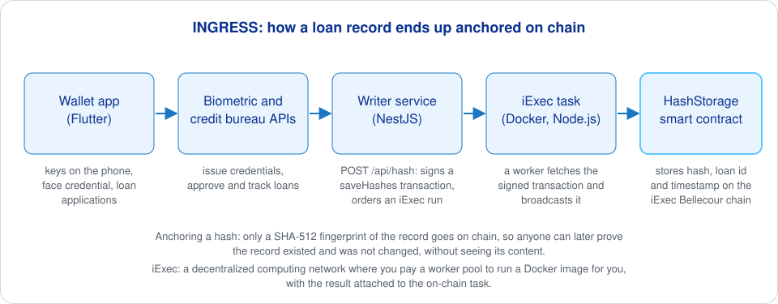

# INGRESS iExec writer

The web service that anchors INGRESS loan records on a blockchain. INGRESS is an Iriscan project from the EU NGI ONTOCHAIN program: biometric credentials and verifiable credit histories for microlending, so that people without a bank can build a record lenders trust. This service takes a batch of record hashes, signs a transaction for the `HashStorage` smart contract and pays an [iExec](https://iex.ec) worker to broadcast it, so the key that owns the contract never has to sit on a public server. It is a NestJS (Node.js) application; the code lives on the `dev` branch.



Anchoring a hash means writing only a fingerprint of a record (here SHA-512) to the chain: anyone can later check that a record existed at a given time and was not altered, while the record itself stays private. iExec is a decentralized computing network: you pay a worker pool to run a Docker image for you, and the result is tied to an on-chain task.

## What it does

- Accepts `POST /api/hash` with 1 to 10 items of `{ hash, loanId, timestamp }`, where `hash` must be a SHA-512 hex string; the request's `Authorization` header must equal `AUTH_KEY`.
- Checks each hash against the contract and drops the ones already stored; if nothing is left it answers "Hashes already pushed".
- Builds and signs a `saveHashes` transaction with the contract owner's key, and stores the signed bytes in a one-time file under `STORAGE_PATH`.
- Publishes an app order for the iExec app if none exists, picks a workerpool order in category 0 from the iExec support pool, creates and signs a request order whose arguments are the RPC URL and the one-time file link, and matches the orders. The worker then runs [ontochain-iexec-task](https://github.com/biometric-technologies/ontochain-iexec-task).
- Serves `GET /api/file/:name` for the worker: the file is returned once and deleted.
- Exposes Swagger documentation for the API.

## How to run

Copy `.env.example` to `.env`:

| Variable | Meaning |
|---|---|
| `AUTH_KEY` | Secret callers must send as the `Authorization` header of `POST /api/hash` (compared as a plain string) |
| `APP_OWNER_PRIVATE_KEY` | Wallet that owns the iExec app and pays for runs |
| `CONTRACT_OWNER_PRIVATE_KEY` | Wallet that owns the `HashStorage` contract (only it may call `saveHashes`) |
| `IEXEC_APP_ADDRESS` | Address of the deployed iExec app (the task Docker image) |
| `HASH_SAVER_CONTRACT_ADDRESS` | Address of the deployed `HashStorage` contract |
| `RPC_URL` | JSON-RPC endpoint; defaults to `https://bellecour.iex.ec`, the iExec sidechain |
| `ORIGIN_URL` | Public base URL of this service, used to build the file link the worker fetches |
| `STORAGE_PATH` | Optional folder for the one-time files, `storage` by default |
| `PORT` | Optional, 5001 by default |

```sh
git checkout dev
yarn install
yarn start           # or: yarn start:dev for watch mode
```

With Docker:

```sh
yarn dockerBuild     # builds biometrictechnologies/ingress-iexec-backend
docker run --env-file .env -p 5001:5001 -v $PWD/storage:/opt/storage biometrictechnologies/ingress-iexec-backend
```

Push a batch:

```sh
curl -X POST http://localhost:5001/api/hash \
  -H "Authorization: $AUTH_KEY" \
  -H "Content-Type: application/json" \
  -d '{"infos":[{"hash":"<128 hex chars>","loanId":"L-1042","timestamp":1700000000}]}'
```

The commented-out block in `src/services/app.service.ts` shows how the iExec app was deployed from the task's Docker image with `iexec.app.deployApp`.

## Related repositories

- [ontochain-iexec-task](https://github.com/biometric-technologies/ontochain-iexec-task): the Docker image the worker runs; it fetches the signed transaction and broadcasts it.
- [ontochain-iexec-smartcontract](https://github.com/biometric-technologies/ontochain-iexec-smartcontract): the `HashStorage` Solidity contract.
- [ontochain-digital-wallet](https://github.com/biometric-technologies/ontochain-digital-wallet): the Flutter wallet users apply for loans with.
- [ingress-site](https://github.com/biometric-technologies/ingress-site): project website with user guides for the wallet and the bureau back offices.

## License

License: not yet specified.

## Contact

info@iriscan.com, https://www.iriscan.com
